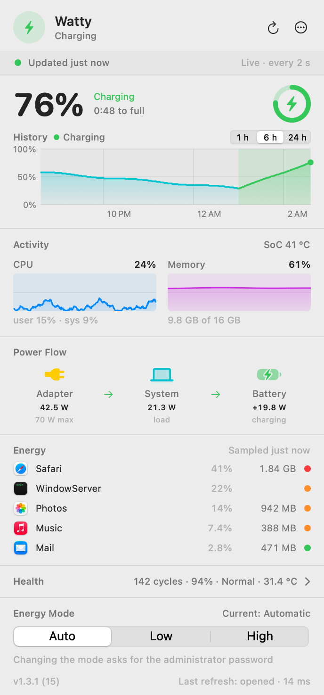
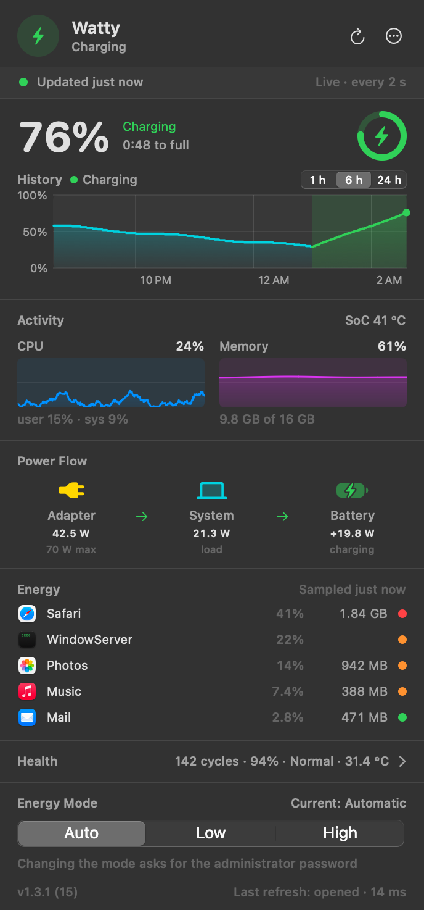
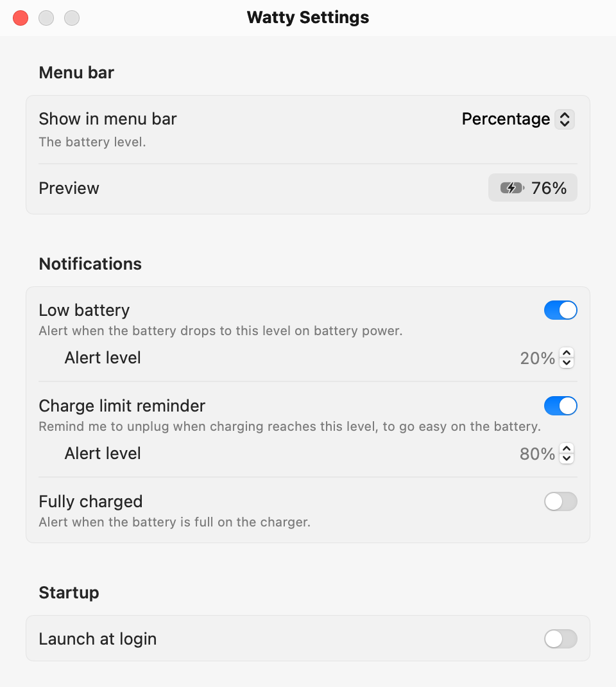
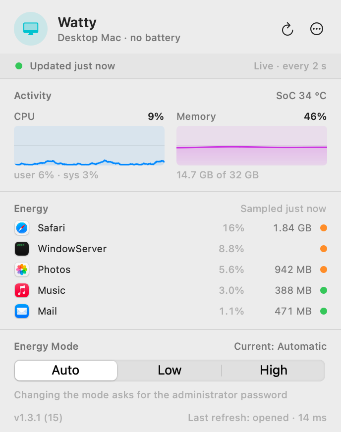

# Watty

Watty is a macOS menu bar app that shows where your Mac's power goes: battery and history, charger and live power flow, chip temperature, and the apps working hardest.

[](https://github.com/jmt-es/Watty/actions/workflows/ci.yml)
[](LICENSE)


<p align="center">
  
  
</p>

## Features

- **Battery and charger**: charge level, charging state and time to full or empty, as macOS reports them. When the charger cannot keep up and the battery loses charge while plugged in, Watty says `Plugged in, draining` instead of repeating `Charging`.
- **History**: a battery chart for the last 1, 6 or 24 hours that survives restarts, with charging periods shaded and, in orange, the periods plugged in where the level fell.
- **Power flow**: what the adapter delivers, what the Mac consumes and what goes into or out of the battery, in watts.
- **Activity**: CPU and memory charts for the last 10 minutes, plus the chip temperature on Apple Silicon.
- **Energy by app**: the busiest apps by CPU share, with their memory footprint. Helper processes are grouped under their app.
- **Battery health**: cycle count, maximum capacity, condition, voltage, current and temperature.
- **Energy mode**: see whether macOS is in Automatic, Low Power or High Power mode, and change it from the panel.
- **Menu bar**: show the percentage, the time remaining, the power in watts, or only the icon.
- **Notifications**: optional alerts for low battery, a charge limit reminder and a full battery.
- **Launch at login**: one switch in Settings, or `brew services` when you install with Homebrew.
- **Command line**: `watty` prints the same data in the terminal, as text or JSON.
- **Desktop Macs**: a Mac without a battery keeps everything except the battery sections.
- **English and Spanish**, following your system language, with VoiceOver labels on the menu bar item, the charts and the panel sections.

Watty observes; it does not control. It never limits charging, and the only system setting it can change is the energy mode, when you ask. If you want to cap the charge at a level, see [BatFi](#acknowledgements).

It stays out of the way: the battery refreshes every 2 seconds while the panel is open and every 30 seconds while it is closed, plus an immediate refresh when you plug in the charger or wake the Mac. See [how it works](docs/how-it-works.md).

## Install

Watty runs on macOS 13 Ventura or later, on Apple Silicon and Intel Macs. See [Requirements](#requirements).

### Homebrew (recommended)

```sh
brew install jmt-es/tap/watty
brew services start watty
```

`brew services start` launches Watty now and at every login. It restarts the app after a crash, not after you choose Quit.

Homebrew builds Watty from source on your Mac, which takes a minute or two and needs the Xcode Command Line Tools (`xcode-select --install`). There is no Apple Developer ID behind this project, so a prebuilt app cannot be notarized; an app you build yourself is never quarantined by Gatekeeper, so macOS shows no security warning.

To open Watty once without the service, or to add a link in `/Applications` that keeps following upgrades:

```sh
open "$(brew --prefix watty)/Watty.app"
ln -sf "$(brew --prefix watty)/Watty.app" /Applications/Watty.app
```

Update with `brew upgrade watty`, and run `brew services restart watty` afterwards if you use the service.

### From source

```sh
git clone https://github.com/jmt-es/Watty.git
cd Watty
make install
```

`make install` builds the release products with SwiftPM, assembles an ad-hoc signed `Watty.app`, installs it in `~/Applications` and opens it. It needs the Xcode Command Line Tools. Options are passed as variables:

```sh
make install INSTALL_DIR=/Applications   # install somewhere else
make install LAUNCH_AGENT=1              # start at login with a LaunchAgent
make install BIN_DIR=~/.local/bin        # also link the watty command
make install RUN_TESTS=1                 # run swift test first
```

`make app` only builds `build/Watty.app`. Run `make help` for every target.

To start Watty at login, use either the switch in Settings or the LaunchAgent from `make install LAUNCH_AGENT=1`, which also restarts the app after a crash and writes logs. Do not use both.

### Prebuilt download

The [releases page](https://github.com/jmt-es/Watty/releases) has a universal zip for Apple Silicon and Intel, with a SHA-256 checksum file next to it. The app is signed ad hoc and not notarized, so macOS blocks the first launch of a downloaded copy:

1. Move `Watty.app` to `/Applications` and open it. macOS says it cannot verify the app; close the message.
2. Open System Settings, go to Privacy & Security, scroll to the message about Watty and choose Open Anyway.

Or remove the quarantine flag before the first launch:

```sh
xattr -dr com.apple.quarantine /Applications/Watty.app
```

Prefer Homebrew when you can: it avoids that step and updates with `brew upgrade`.

## Command line

Homebrew installs the `watty` command. Without Homebrew, the command is inside the app; [docs/cli.md](docs/cli.md#install) shows how to link it.

```sh
watty status           # battery, charger and power flow right now
watty status --json    # the same, for scripts
watty top              # apps by CPU use
watty watch            # keep refreshing in the terminal
watty show             # open the panel
```

See [docs/cli.md](docs/cli.md) for every option, the JSON format and recipes for tmux and SketchyBar.

## Settings and desktop Macs

<p align="center">
  
  
</p>

Open Settings from the menu at the top right of the panel. Choose what the menu bar shows (the percentage, the time remaining, the power in watts, or only the icon), turn on the notifications you want (all are off by default) and set Watty to launch at login. With Homebrew, Settings shows the `brew services` command instead of the login switch.

On a Mac without a battery, such as a Mac mini, Mac Studio or iMac, Watty hides the battery sections and the menu bar shows the CPU usage.

## Privacy

Watty makes no network requests. It has no analytics, no crash reporting and no update check, and its source contains no networking code. Everything it reads comes from macOS on your Mac and stays there.

It writes only its own settings and 24 hours of battery history (time, level and charging state, no app names) in `~/Library/Application Support/Watty`. See [what is stored and where](docs/how-it-works.md#what-is-stored-and-where).

## Permissions

Watty needs no special permissions: no Accessibility, no Full Disk Access, no Screen Recording, no location.

- An administrator password is asked only when you change the energy mode. macOS shows its own authorization prompt, and Watty never sees or stores the password. Cancel the prompt and nothing changes.
- If you turn on notifications, macOS asks once for permission to show them.
- If you turn on Launch at login, macOS may ask you to approve Watty in System Settings, under General and Login Items.

## Requirements

- macOS 13 Ventura or later, on Apple Silicon or Intel.
- A MacBook for the battery features. On a Mac without a battery the battery sections are hidden and everything else keeps working.
- The chip temperature needs an Apple Silicon Mac.
- To build from source: the Xcode Command Line Tools with Swift 5.9 or later. Running the tests also needs XCTest, which comes with Xcode.

## Troubleshooting

**The menu bar icon is hidden.** On a MacBook with a notch, or behind a menu bar manager, the item can end up out of sight. Open the panel in a regular window with `watty show`. Without the command line tool, open Watty again while it is running, from `/Applications` or with `open -b com.jmtes.watty`. From the panel, Settings lets you choose a narrower menu bar display, such as the icon alone.

**Homebrew says the Command Line Tools are outdated.** The message reads "Your Command Line Tools (CLT) does not support macOS N". Homebrew will not build with tools older than your macOS. Update them in System Settings, under General and Software Update, then run the install again. If Software Update offers nothing, remove the tools and install them again:

```sh
sudo rm -rf /Library/Developer/CommandLineTools
sudo xcode-select --install
```

**The app does not start or quits unexpectedly.** Read the logs. With Homebrew they are in `$(brew --prefix)/var/log/watty.log`; with `make install LAUNCH_AGENT=1`, in `~/Library/Logs/Watty/stderr.log`. To watch what the app is doing live (use the full path, because zsh has its own `log` command):

```sh
/usr/bin/log stream --predicate 'subsystem == "com.jmtes.watty"' --level debug
```

To restart it, use `brew services restart watty`, or for the LaunchAgent `launchctl kickstart -k gui/$(id -u)/com.jmtes.watty`.

**The energy mode does not change.** macOS decides which modes a Mac supports and when it honors them. If the system keeps another mode, the control returns to the real one and says why.

**Notifications do not appear.** If macOS notifications are off for Watty, Settings says so and has a button that opens System Settings. Notifications also need Watty to run as an app, not straight from the build folder with `swift run`.

**The temperature shows `---`.** Watty reads the temperature sensors of Apple Silicon chips. Intel Macs and virtual machines generally expose none.

**`swift test` cannot find XCTest.** Install Xcode, or skip the tests; building and installing do not need it.

## Uninstall

With Homebrew:

```sh
brew services stop watty
brew uninstall watty
rm -f /Applications/Watty.app    # only if you added the link above
```

From source, run `make uninstall`. It removes the app, its LaunchAgent and the logs. Add `UNINSTALL_ARGS=--purge` to also delete the settings and battery history:

```sh
make uninstall UNINSTALL_ARGS=--purge
```

For any other install, turn off Launch at login in Settings, quit Watty and move `Watty.app` to the Trash. To delete its data as well:

```sh
rm -rf ~/Library/Application\ Support/Watty
defaults delete com.jmtes.watty
```

## Documentation

- [How Watty works](docs/how-it-works.md): where every number comes from, how often it is read and its limits.
- [Command line reference](docs/cli.md): commands, options, exit codes and the JSON schema.
- [Changelog](CHANGELOG.md): what changed in each release.

## Contributing

Issues and pull requests are welcome. Read [CONTRIBUTING.md](CONTRIBUTING.md) first: it covers building, testing, the code style and how the screenshots are made. To report a vulnerability, follow [SECURITY.md](SECURITY.md) instead of opening an issue.

## Acknowledgements

Watty is inspired by [BatFi](https://github.com/rurza/BatFi) by rurza, a battery charge limiter for macOS released under the MIT license. It set the example for what a focused battery utility in the menu bar can be. Thank you, rurza.

The two do different jobs. BatFi limits how far your battery charges. Watty observes where the power goes and never limits charging. If you want to cap the charge at 80% or any other level, use BatFi.

## License

[MIT](LICENSE) © 2026 Javier Martinez Tornero.
